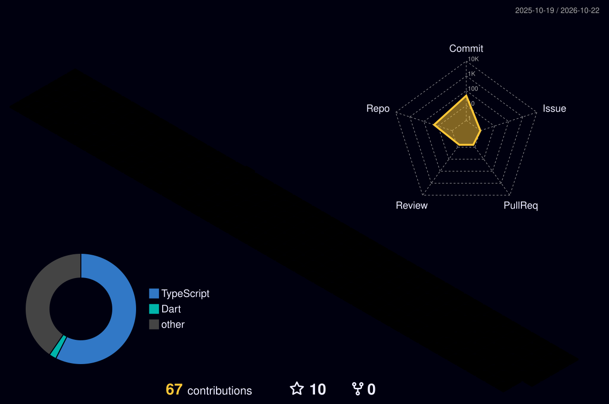

<div align="center">



<br/>


<br/>

<a href="https://www.linkedin.com/in/sarfaraj-alam-536b51291/"></a>
<a href="mailto:sarfarajbabu748@gmail.com"></a>
<a href="https://pub.dev/packages/taplatch"></a>


</div>


## 👨‍💻 About Me

```dart
class SarfarazAlam extends Developer {
  final role      = 'Cross-Platform App Developer';
  final location  = 'India 🇮🇳';
  final platforms = ['Android', 'iOS', 'Web'];

  final frontend  = ['Flutter', 'Dart', 'React Native', 'Next.js'];
  final backend   = ['Firebase', 'Supabase', 'Cloud Functions', 'Cloudinary'];
  final apis      = ['REST APIs', 'Postman Testing', 'Third-party Integrations'];
  final shipping  = ['Firebase Hosting', 'GoDaddy Domains', 'Play Store', 'App Store'];

  String get motto => 'Idea ➜ Design ➜ Code ➜ Test ➜ Live 🚀';
}
```


## ⚙️ How I Ship a Product

<div align="center">

</div>


## 🧰 Tech Arsenal

<div align="center">

</div>


## 🚀 Featured Projects

<table>
<tr>
<td width="50%" valign="top">

### 🏥 Restore Health Services
**Healthcare Marketplace**

Medicines, blood tests, doctor consultation and health services in one app.


</td>
<td width="50%" valign="top">

### 🚗 Sampark
**QR Vehicle Communication**

Contact any vehicle owner by scanning a QR, without sharing personal numbers.


</td>
</tr>
<tr>
<td width="50%" valign="top">

### 🛣️ RoadPulse
**Smart Road Safety Platform**

Report and track potholes, speed breakers and road hazards on a live map.


</td>
<td width="50%" valign="top">

### 🧠 BrainBoost
**Offline Education App**

Offline lessons and MCQ practice for students, no internet needed.


</td>
</tr>
<tr>
<td colspan="2" valign="top" align="center">

### 🔗 TapLatch — Open-Source Flutter Package
Prevents accidental double-taps, with loading, success and cooldown states.

<a href="https://pub.dev/packages/taplatch"></a>
<a href="https://pub.dev/packages/taplatch"></a>

</td>
</tr>
</table>


## 🧊 3D Contribution City

<div align="center">

</div>


## 📊 GitHub Stats

<div align="center">


</div>

## 🐍 Contribution Snake

<div align="center">

</div>


<div align="center">

### 🤝 Let's build something together

Freelance app, startup MVP or full-time role — I'm ready.

<a href="mailto:sarfarajbabu748@gmail.com"></a>


</div>
